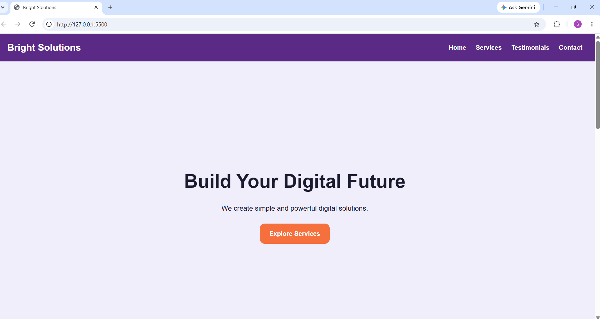

# Bright Solutions

## Description

Bright Solutions is a responsive company landing page
built using HTML and CSS.

## Screenshot

## Features

- Responsive navigation bar
- Full-screen hero section
- Three service cards
- Customer testimonials
- Contact form
- Responsive layout for mobile, tablet and desktop

## Technologies Used

- HTML5
- CSS3
- CSS Grid
- Flexbox
- Media Queries

## How to Run

1. Download or clone the repository.
2. Open the project folder.
3. Open index.html in a browser.

## Author

**Snekha, R** – HackGeniX Intern, Batch 1